# Sagar Kinare — Database Entity-Relationship Diagram (ERD)

This document details the complete relational database schema for the Sagar Kinare event operations platform, including table structures, keys, constraints, and relationship cardinalities across all 16 tables.

---

## 1. Mermaid Entity-Relationship Diagram

```mermaid
erDiagram
    users ||--o{ audit_logs : "triggers"
    users ||--o{ checkins : "performs"
    users ||--o{ checkin_attempts : "logs"
    users ||--o{ seat_allocations : "authorized_by"
    users ||--o{ reconciliation_cases : "resolved_by"

    events ||--|{ ticket_categories : "defines"
    events ||--o{ bookings : "hosts"
    events ||--o{ tickets : "admits_to"
    events ||--o{ seat_allocations : "reserves"
    events ||--o{ event_settings : "configures"

    contacts ||--o{ bookings : "initiates"

    bookings ||--|{ booking_items : "contains"
    bookings ||--o{ inventory_holds : "holds"
    bookings ||--o{ payments : "settled_by"
    bookings ||--o{ tickets : "issues"
    bookings ||--o{ reconciliation_cases : "escalates_to"

    ticket_categories ||--o{ booking_items : "specifies"
    ticket_categories ||--o{ inventory_holds : "locks"
    ticket_categories ||--o{ tickets : "categorizes"
    ticket_categories ||--o{ seat_allocations : "deducts_from"

    payments ||--o{ reconciliation_cases : "flags"

    tickets ||--o| checkins : "admitted_via"
    tickets ||--o{ checkin_attempts : "audited_in"

    users {
        bigint id PK
        string name
        string email UK
        string password
        string role "SUPER_ADMIN, EVENT_MANAGER, FINANCE, GATE_STAFF"
        timestamp email_verified_at
        timestamps created_at_updated_at
    }

    events {
        bigint id PK
        string slug UK
        string name
        string venue_name
        string venue_address
        string city
        timestamp starts_at
        timestamp ends_at
        integer total_capacity "450 shared capacity limit"
        string status "DRAFT, PUBLISHED, ARCHIVED"
        timestamps created_at_updated_at
    }

    ticket_categories {
        bigint id PK
        bigint event_id FK
        string name "Tier 1 Premium, Tier 2 Classic, Tier 3 Standard"
        integer price_paise "₹2500, ₹1500, ₹1000 in paise"
        integer total_quota "100, 100, 250"
        integer max_per_booking "Default: 6"
        boolean is_active
        timestamps created_at_updated_at
    }

    contacts {
        bigint id PK
        string email UK
        string full_name
        string phone
        string city
        string notes
        timestamps created_at_updated_at
    }

    bookings {
        bigint id PK
        string booking_reference UK "SK-YYYYMMDD-XXXX"
        bigint event_id FK
        bigint contact_id FK
        string status "PENDING, PAID, EXPIRED, CANCELLED, RECONCILIATION_REQUIRED"
        integer total_amount_paise
        integer total_quantity
        string idempotency_key UK
        timestamps created_at_updated_at
    }

    booking_items {
        bigint id PK
        bigint booking_id FK
        bigint ticket_category_id FK
        integer quantity
        integer unit_price_paise
        integer subtotal_paise
        timestamps created_at_updated_at
    }

    inventory_holds {
        bigint id PK
        bigint booking_id FK
        bigint ticket_category_id FK
        integer quantity
        timestamp expires_at
        string status "ACTIVE, CONVERTED, RELEASED"
        timestamps created_at_updated_at
    }

    payments {
        bigint id PK
        bigint booking_id FK
        string gateway_payment_id UK "Razorpay pay_xxx"
        string gateway_order_id "Razorpay order_xxx / qr_xxx"
        string payment_method "UPI_QR, UPI_INTENT, CARD, NETBANKING"
        integer amount_paise
        string currency "INR"
        string status "INITIATED, SUCCESS, FAILED, REFUNDED, RECONCILIATION_REQUIRED"
        string failure_reason
        json raw_response
        timestamps created_at_updated_at
    }

    gateway_webhook_events {
        bigint id PK
        string event_id UK "Razorpay webhook event x-razorpay-event-id"
        string event_type "payment.captured, payment.failed, etc."
        json raw_payload
        string status "PROCESSED, REJECTED, DUPLICATE"
        timestamps created_at_updated_at
    }

    reconciliation_cases {
        bigint id PK
        bigint booking_id FK
        bigint payment_id FK
        string reason "AMOUNT_MISMATCH, LATE_PAYMENT_OVER_CAPACITY, UNASSOCIATED_PAYMENT"
        integer expected_amount_paise
        integer received_amount_paise
        string status "OPEN, RESOLVED, REFUNDED"
        bigint resolved_by FK
        text notes
        timestamps created_at_updated_at
    }

    tickets {
        bigint id PK
        string ticket_number UK "TKT-SK-XXXX-XXXX"
        bigint event_id FK
        bigint booking_id FK
        bigint ticket_category_id FK
        string attendee_name
        string hmac_nonce UK "High-entropy cryptographic nonce"
        string hmac_signature "HMAC-SHA256(APP_KEY, ticket_id + nonce)"
        string status "ACTIVE, ADMITTED, VOID, CANCELLED"
        timestamps created_at_updated_at
    }

    checkins {
        bigint id PK
        bigint ticket_id UK "Strict 1-to-1: guarantees exactly one accepted check-in per ticket"
        bigint scanned_by FK
        string method "QR_SCAN, MANUAL_LOOKUP"
        timestamp checked_in_at
        timestamps created_at_updated_at
    }

    checkin_attempts {
        bigint id PK
        bigint ticket_id FK
        bigint scanned_by FK
        string result "VALID, ALREADY_CHECKED_IN, INVALID_STATUS, NOT_FOUND"
        string failure_reason
        timestamps created_at_updated_at
    }

    seat_allocations {
        bigint id PK
        bigint event_id FK
        bigint ticket_category_id FK
        string allocation_type "COMPLIMENTARY, SPONSOR, ORGANISER"
        string recipient_name
        string recipient_contact
        integer quantity
        bigint authorized_by FK
        text notes
        timestamps created_at_updated_at
    }

    audit_logs {
        bigint id PK
        bigint user_id FK
        string action "BOOKING_CREATED, PAYMENT_VERIFIED, TICKET_VOIDED, MANUAL_CHECKIN, etc."
        string auditable_type
        bigint auditable_id
        json old_values
        json new_values
        string ip_address
        string user_agent
        timestamps created_at_updated_at
    }

    event_settings {
        bigint id PK
        bigint event_id FK
        string key "hold_ttl_minutes, event_publication_enabled, live_payments_enabled, etc."
        text value
        timestamps created_at_updated_at
    }
```

---

## 2. Invariant Constraints & Data Integrity

1. **Anti-Oversell Quota Lock (`InnoDB FOR UPDATE`):**
   * Shared capacity constraint: `SUM(active_holds) + COUNT(active_or_admitted_tickets) + SUM(seat_allocations) <= 450`.
   * Enforced via row-level pessimistic locking in `InventoryService::reserveInventory()`.

2. **Atomic Single-Admission Gate Check-in:**
   * Table `checkins` has a unique database key: `UNIQUE KEY unique_ticket_checkin (ticket_id)`.
   * When two gate volunteers scan the same QR code concurrently, the first insert succeeds and yields `Green (Valid)`. The second insert immediately triggers a duplicate key conflict, catches the exception, logs a `checkin_attempts` row with `result = ALREADY_CHECKED_IN`, and returns `Orange (Already Used)` with the original check-in timestamp.

3. **Webhook Deduplication & Idempotency:**
   * Table `gateway_webhook_events` enforces `UNIQUE KEY unique_provider_event (event_id)`. Duplicate webhook deliveries from Razorpay are acknowledged with HTTP 200 without executing duplicate database mutations or duplicate ticket generation.

4. **Zero-PII High-Entropy Admission Token:**
   * Admission QR string payload format: `sk_adm_{ticket_number}_{hmac_nonce}_{hmac_signature}`.
   * Contains no customer name, email, phone number, or pricing information. Can be re-rendered on demand from the stored nonce and HMAC signature.
