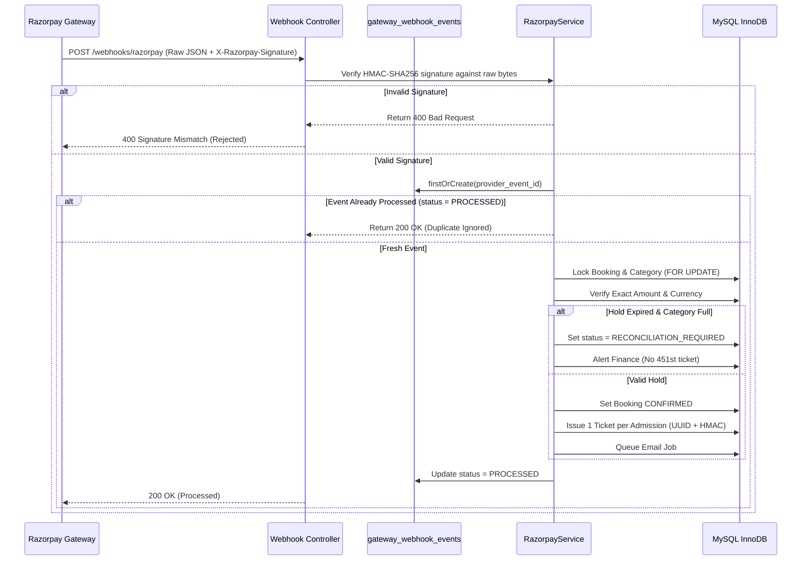

# Razorpay Integration Notes & Webhook Lifecycle

---

## 1. Dynamic UPI QR Codes vs. Mobile Intent Fallback

### A. Finding & Feature Availability
Under the Razorpay QR Codes API (`POST https://api.razorpay.com/v1/payments/qr_codes`):
* Razorpay generates a dynamic single-use UPI QR code (`usage: 'single_use'`, `fixed_amount: true`, `type: 'upi_qr'`).
* It returns an `image_url` and short hosted page link (`https://rzp.io/i/...`).
* **Merchant Readiness Concern:** Dynamic QR Code APIs are not automatically enabled on standard self-serve Razorpay merchant accounts without banking partner approval.

### B. Architectural Fallback (Seamless Engine)
The platform implements `App\Services\RazorpayService`:
1. If Razorpay dynamic QR creation succeeds, it stores the `provider_qr_id` and hosted `image_url`.
2. If the API returns a capability error (or for same-phone mobile users), it creates a Razorpay Order (`/v1/orders`), generates a standard client-side `upi://pay` intent link, and enables the modal Razorpay Checkout.
3. **Identical Fulfilment Pipeline:** Both approaches feed the identical backend webhook receiver, raw signature verification, deduplication engine, and ticket issuance pipeline.

---

## 2. Webhook Event Lifecycle & Deduplication Architecture

---

## 3. Webhook Security Invariants

* **Raw Byte Verification:** `hash_equals(hash_hmac('sha256', $rawPayload, $secret), $signature)`. Parsed or re-encoded JSON arrays are never used for signature verification to prevent whitespace/key order tampering.
* **Idempotency Guarantee:** Provider event IDs are recorded with a database `UNIQUE` constraint in `gateway_webhook_events`. Repeated deliveries from network retries will not duplicate tickets or charge records.
* **Out-of-Order Handling:** If an event arrives when the booking is already confirmed, the handler marks the webhook processed without side effects.
